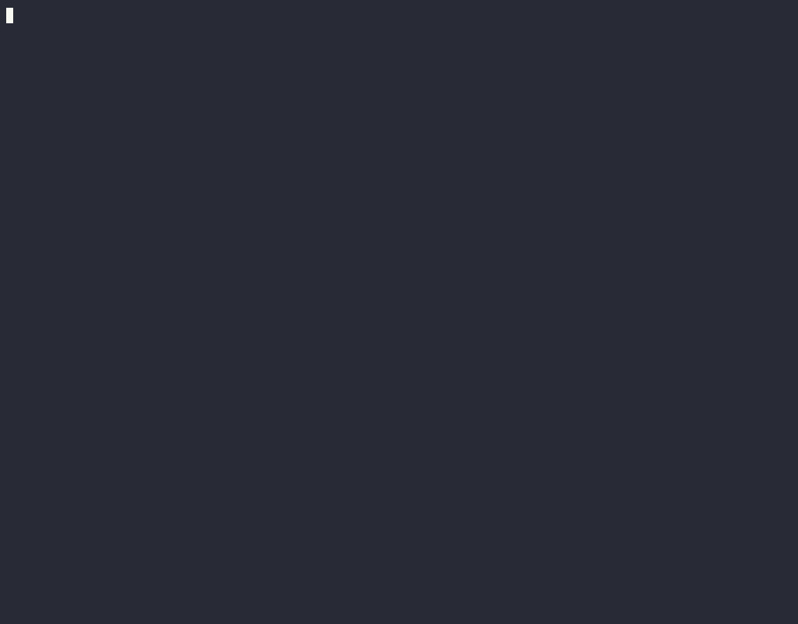

# XeFM — デスクトップでもターミナルでも使える 2 画面ファイルマネージャー

[English](README.md) \| 日本語

XeFM（*Xenolith File Manager* の略）は、キーボード操作中心の 2 画面ファイルマネージャーです。**Windows と macOS** ではネイティブのデスクトップアプリとして、**Windows、macOS、Linux** ではターミナルで動作します。SSH サーバー、S3 バケット、アーカイブも普通のフォルダーと同じように開けます。また、ほぼすべての動作を Python で自由に変えられます。[既製の拡張機能](https://github.com/crftwr/xefm/wiki/Extensions)をインストールすることも、自分で書くことも、[XeFM スキル](doc/AGENT_SKILL_FEATURE.ja.md)を使って AI コーディングエージェントに書かせることもできます。

<p>
  <a href="https://apps.microsoft.com/detail/9PK2X44W810V">
    
  </a>
  &nbsp;
  <a href="https://github.com/crftwr/xefm/releases/latest">
    
  </a>
  &nbsp;
  <a href="https://pypi.org/project/xefm/">
    
  </a>
</p>


<table>
  <tr>
    <th width="50%">GUI（macOS）</th>
    <th width="50%">TUI</th>
  </tr>
  <tr>
    <td>

https://github.com/user-attachments/assets/f121401d-990b-445d-aa79-526d34e4a44e

</td>
    <td></td>
  </tr>
</table>

## 主な機能

- **クロスプラットフォーム** - **Windows と macOS** ではネイティブのデスクトップアプリ、**Windows、macOS、Linux** ではターミナル（TUI）アプリとして動作
- **2 画面表示** - 左右のペインを別々に移動でき、ペインをまたいだ操作が可能
- **アーカイブのブラウズ** - ZIP、TAR、圧縮アーカイブを仮想ディレクトリとして移動
- **SFTP 対応** - SSH 経由でリモートサーバーを高速にブラウズ・管理
- **AWS S3 対応** - クラウドストレージを操作
- **サーバーへ接続** - ネットワーク上のファイルサーバーを探し、共有をブラウズしてマウントするまでを XeFM の中で完結。Finder やエクスプローラーに寄り道する必要はありません（macOS と Windows）
- **高度な検索** - リアルタイムの絞り込み、バックグラウンド処理、複数選択による一括操作
- **OS のインデックス検索** - 検索ダイアログから Spotlight（macOS）や Windows Search を検索し、見つかったファイルをファイル一覧として操作（[詳細](doc/OS_INDEX_SEARCH_FEATURE.ja.md)）
- **お気に入りとタグ** - ディレクトリやファイルをお気に入りに登録。システムが持つタグをそのまま読み書きするので、Finder で付けたタグが XeFM に表示され、その逆も同様です（[詳細](doc/FILE_TAGS_FEATURE.ja.md)）
- **充実した内蔵ビューアー** - シンタックスハイライト付きテキスト、画像、Markdown、JSON、CSV/TSV
- **比較と同期** - テキストファイルを左右に並べ、変更箇所を文字単位で示す差分表示。ディレクトリの再帰的な比較と、1 回の操作で済む同期（更新またはミラー）。同期では、書き込む前に実行内容をすべて確認できます（[差分](doc/DIFF_VIEWER_FEATURE.ja.md)、[同期](doc/DIRECTORY_SYNC_FEATURE.ja.md)）
- **類似ファイルの検索** - 重複ファイルに加え、サイズ変更、再エンコード、メタデータの書き換えをしただけで中身は同じ画像、動画、音声を検出（[詳細](doc/FIND_SIMILAR_FILES_FEATURE.ja.md)）
- **テーマと視覚効果** - 10 種類以上の内蔵テーマ。デスクトップモードでは GPU による背景アニメーション、CRT／蛍光体風の画面効果、テキストが浮かび上がるアニメーションも使えます
- **4 つのキーマッププリセット** - AFX style（1 つの文字キーで 1 つのコマンド）、Orthodox（ファンクションキー）、OS native（Finder やエクスプローラーのキー）、Vim style から、初回起動時に選択（[詳細](doc/KEYMAP_PRESETS_FEATURE.ja.md)）
- **カスタマイズ性** - キーバインド、設定項目、外部プログラムの起動をすべて自由に変更可能。コマンドパレットからは、すべてのアクションを名前で探せます
- **拡張機能** - アクション、テーマ、フィルター、シンタックスハイライトなどを追加するパッケージをインストール（[一覧を見る](https://github.com/crftwr/xefm/wiki/Extensions)）。XeFM スキルを使えば AI エージェントに書かせることもできます

## クイックスタート

### インストール

XeFM をどう使いたいかに合わせてインストール方法を選んでください。

| | 入手先 | 内容 |
|---|---|---|
| **デスクトップアプリ** — Windows | **[Microsoft Store](https://apps.microsoft.com/detail/9PK2X44W810V)** | Microsoft の署名付きで、通常のアプリとしてインストールされます。ワンクリックで導入でき、自動更新され、SmartScreen の警告も出ません。Python は不要です。 |
| **デスクトップアプリ** — macOS | [最新リリース](https://github.com/crftwr/xefm/releases/latest)、または Homebrew：`brew install --cask crftwr/tap/xefm` | 通常のアプリとしてインストールされ、専用のアイコンと Dock 項目を持ち、ファイルアクセス権限も XeFM 自身に与えられます。Python は不要です。 |
| **ターミナルアプリ** — Windows、macOS、Linux | [PyPI](https://pypi.org/project/xefm/) | どのターミナルからでも（SSH 越しでも）使える `xefm` コマンド。Python 3.10 以上が必要です。 |
| **ターミナルアプリ** — macOS、Linux | Homebrew：`brew install crftwr/tap/xefm` | Homebrew で管理される同じ `xefm` コマンド。自分で Python ライブラリを追加したい場合は PyPI 版を使ってください。 |

デスクトップアプリとターミナルアプリは共存でき、設定は `~/.xefm/` で共有されます。両方をインストールして使うのも、ごく普通の構成です。

### デスクトップアプリ（Windows、macOS）

デスクトップ版のパッケージは Python を同梱しているので、ほかに何もインストールする必要はありません。

**Windows** — **[Microsoft Store](https://apps.microsoft.com/detail/9PK2X44W810V)** からインストールするか、`winget install --id 9PK2X44W810V --source msstore` を実行します。XeFM はスタートメニューに登録され、自動で更新され、*設定 → アプリ* からアンインストールできます。署名なしの**ポータブル zip** もすべての[リリース](https://github.com/crftwr/xefm/releases/latest)に添付されています。こちらは最初に一度[ブロックの解除](doc/DESKTOP_MODE_GUIDE.ja.md#windows--ポータブル-zip)が必要です。

**macOS** — **[最新リリース](https://github.com/crftwr/xefm/releases/latest)** から `XeFM-<version>-macos.dmg` をダウンロードし、**XeFM** を *アプリケーション* にドラッグして、Launchpad か Spotlight から起動します。作者の Apple Developer ID で署名されています。Homebrew にインストールとアップグレードを任せることもできます。

```bash
brew install --cask crftwr/tap/xefm
```

Gatekeeper に関する注意を含むインストールの詳細は **[デスクトップモードガイド](doc/DESKTOP_MODE_GUIDE.ja.md#デスクトップアプリのパッケージのインストール)** にあります。

> **`xefm --backend gui` ではなくパッケージを使ってください** — この起動方法は XeFM の開発用で、普段使うためのものではありません。Dock／タスクバーのアイコンや、macOS ではファイルアクセス権限が、XeFM ではなく Python やターミナルのものとして扱われてしまいます。[`xefm --backend gui` ではいけないのはなぜですか？](doc/DESKTOP_MODE_GUIDE.ja.md#xefm---backend-gui-ではいけないのはなぜですか) を参照してください。

### ターミナルアプリ（Windows、macOS、Linux）

XeFM は [PyPI](https://pypi.org/project/xefm/) で公開されています。ツールとしてインストールしてそのまま実行できます。リポジトリのチェックアウトも仮想環境の管理も不要です。

```bash
pipx install xefm     # or:  uv tool install xefm,  or:  pip install xefm
xefm
```

[pipx](https://pipx.pypa.io) と [uv](https://docs.astral.sh/uv/) は、XeFM を専用の環境に入れたうえで `xefm` コマンドを PATH に置いてくれます。`uvx xefm` なら何もインストールせずに一度だけ試せます。必要なのは Python 3.10 以上だけです。SSH セッション、リモートサーバー、ターミナル中心の作業にはこのインストール方法が向いています。

macOS と Linux では、Homebrew でターミナルアプリをインストールすることもできます。

```bash
brew install crftwr/tap/xefm
```

`config.py` で XeFM に同梱されていないライブラリを import している場合や、`pillow-heif` のような Pillow プラグインを使いたい場合は、`~/.xefm/requirements.txt` に書いて `xefm deps sync`（または Tools → Advanced → Sync Python Packages）を実行してください。デスクトップアプリを含むどのインストール方法でも同じように動き、アップグレード後も残ります。[追加の Python ライブラリ](doc/PYTHON_PACKAGES_FEATURE.ja.md)を参照してください。

**アップグレードはインストールしたときと同じツールで行ってください**（`pipx upgrade xefm`、`uv tool upgrade xefm`、`pip install --upgrade xefm`、`brew upgrade xefm`）。ツールを混ぜて使うことはできません。詳細とよくあるインストールエラーの対処法は[ユーザーガイド](doc/XEFM_USER_GUIDE.ja.md#アップグレードとアンインストール)にあります。

### ソースから

XeFM 自体を開発する場合は、リポジトリをクローンして使います。

```bash
git clone https://github.com/crftwr/xefm.git
cd xefm
make venv        # creates .venv with every dependency
make run         # launch XeFM through it, no activation needed
```

そのほかのターゲット（editable インストール、PuiKit との同時開発、macOS／Windows のアプリバンドル）は `make help` で一覧できます。

### 基本操作

初回起動時に、4 つの[キーマッププリセット](doc/KEYMAP_PRESETS_FEATURE.ja.md)（AFX style、Orthodox、OS native、Vim style）のどれを使うかを選びます。後から **Tools → Advanced → Keymap…** で切り替えられます。次の操作はどのプリセットでも同じです。

- **移動：** 矢印キーでカーソルを移動、`Enter` で開く、`Backspace` で親ディレクトリへ、`Tab` でペインを切り替え
- **ヘルプ：** `F1` でヘルプダイアログが開き、使っているプリセットのすべてのキーがカテゴリー別に表示されます。キーを覚えておく必要はありません
- **そのほかの操作：** メニューバー（`F10`）とコマンドパレット（**Tools → Command Palette…**）に、すべてのコマンドがキーと一緒に並んでいます
- **リモートパス：** `ssh://hostname/path` や `s3://bucket/path` を普通のディレクトリと同じように開けます

4 つのプリセットのすべてのキーは、[キーマッププリセット](doc/KEYMAP_PRESETS_FEATURE.ja.md#すべてのキーの一覧)のページに並べて載せています。

## ドキュメント

### ユーザー向けドキュメント
- **[ユーザーガイド](doc/XEFM_USER_GUIDE.ja.md)** - すべての機能、設定、使い方を網羅したガイド
- **[設定](doc/CONFIGURATION_FEATURE.ja.md)** - 設定のリファレンスとカスタマイズガイド
- **[デスクトップモード](doc/DESKTOP_MODE_GUIDE.ja.md)** - Windows／macOS ネイティブのデスクトップアプリの導入とオプション
- **[キーマッププリセット](doc/KEYMAP_PRESETS_FEATURE.ja.md)** - 4 つのキーマップと、それぞれのすべてのキーの一覧
- **[配色と視覚効果](doc/COLOR_SCHEMES_FEATURE.ja.md)** - テーマ、テーマで切り替えられる GPU 背景シーン、画面効果
- **[画像ビューアー](doc/IMAGE_VIEWER_FEATURE.ja.md)**、**[Markdown ビューアー](doc/MARKDOWN_VIEWER_FEATURE.ja.md)**、**[JSON／CSV ビューアー](doc/JSON_CSV_VIEWERS_FEATURE.ja.md)** - 内蔵ビューアー
- **[差分ビューアー](doc/DIFF_VIEWER_FEATURE.ja.md)**、**[一括リネーム](doc/BATCH_RENAME_FEATURE.ja.md)** - ファイル／ディレクトリの差分表示と、正規表現による複数ファイルの名前変更
- **[SFTP 対応](doc/SFTP_SUPPORT_FEATURE.ja.md)** - SSH 経由のリモートサーバーアクセス、ファイル操作、検索
- **[AWS S3 対応](doc/S3_SUPPORT_FEATURE.ja.md)** - クラウドストレージとの連携と S3 バケットの管理
- **[サーバーへ接続](doc/CONNECT_TO_SERVER_FEATURE.ja.md)** - XeFM から離れずに行う、SMB／WebDAV 共有のマウントとボリュームの切断・取り出し
- **[アーカイブ](doc/ARCHIVE_FEATURE.ja.md)** - アーカイブの作成、展開、ディレクトリとしてのブラウズ
- **[Migemo 検索](doc/MIGEMO_SEARCH_FEATURE.ja.md)** - インクリメンタルサーチで、ローマ字入力から日本語にマッチ
- **[検索アニメーション](doc/SEARCH_ANIMATION_FEATURE.ja.md)** - 高度な検索機能と視覚的なフィードバック
- **[フォルダータブ](doc/FOLDER_TABS_FEATURE.ja.md)**、**[クイックビュー](doc/QUICK_VIEW_FEATURE.ja.md)**、**[コマンドパレット](doc/COMMAND_PALETTE_FEATURE.ja.md)** - 1 つのペインで開く複数の場所、反対側のペインでのライブプレビュー、名前で実行できるすべてのアクション
- **[OS のインデックス検索](doc/OS_INDEX_SEARCH_FEATURE.ja.md)**、**[ファイルリスト](doc/FILE_LIST_IMPORT_FEATURE.ja.md)** - Spotlight／Windows Search の結果や、任意のツールが出力したパスの一覧をペインとして表示
- **[類似ファイルの検索](doc/FIND_SIMILAR_FILES_FEATURE.ja.md)** - 同一ファイルと、似た画像、動画、音声
- **[拡張パッケージ](doc/EXTENSIONS_FEATURE.ja.md)** - 拡張機能のインストール、アップグレード、作成
- **[AI エージェント向け XeFM スキル](doc/AGENT_SKILL_FEATURE.ja.md)** - 設定の編集や拡張機能の作成を AI コーディングエージェントに任せる方法

機能ガイドの一覧は[ユーザーガイド](doc/XEFM_USER_GUIDE.ja.md#機能ドキュメント)の末尾にあります。
レシピやコミュニティの拡張機能は **[XeFM wiki](https://github.com/crftwr/xefm/wiki)** にまとめられています。

### 開発者向けドキュメント（英語）
- **[Project Structure](doc/dev/PROJECT_STRUCTURE.md)** - リポジトリの構成と各部分の置き場所
- **[Path Polymorphism System](doc/dev/PATH_POLYMORPHISM_SYSTEM.md)** - ストレージに依存しない設計と拡張性
- **[Navigation System](doc/dev/NAVIGATION_SYSTEM.md)** - ナビゲーションの中核の実装
- **[External Programs](doc/dev/EXTERNAL_PROGRAMS_SYSTEM.md)** - 外部プログラム連携の仕組み

## アーカイブを仮想ディレクトリとしてブラウズ

アーカイブファイル（`.zip`、`.tar`、`.tar.gz`、`.tgz`、`.tar.bz2`、`.tar.xz`）の上で `Enter` を押すと、普通のディレクトリと同じようにブラウズできます。展開は不要です。アーカイブの中でも、入れ子のディレクトリの移動、ファイルの表示、名前や内容での検索ができ、いつもの操作でファイルを取り出せます。`Backspace` でアーカイブから出ます。**File → Create Archive…** と **File → Extract Archive…** でアーカイブの作成と展開ができます。[アーカイブ機能ガイド](doc/ARCHIVE_FEATURE.ja.md)を参照してください。

## 内蔵ファイルビューアー

ファイルの上で `Enter` を押すと表示します。XeFM はファイルの種類に合ったビューアーを選びます。テキストはシンタックスハイライト付きで表示し（20 以上の形式、行番号、折り返し、ファイル内検索）、画像は拡大縮小とスクロールができます（iTerm2／kitty／sixel 対応ターミナルとデスクトップモードではインライン表示）。Markdown、JSON、CSV/TSV は*整形表示*になり、キー 1 つで生テキスト表示に切り替えられます。どのビューアーも、ローカルファイル、アーカイブの中、リモートの SFTP／S3 パスで、展開やダウンロードなしに使えます。


| Markdown | JSON / JSONL | CSV / TSV |
|:---:|:---:|:---:|
|  |  |  |
| 見出し、リスト、コード、リンクを整形表示 | 折りたためる色分けされたツリー（`.json`、`.jsonl`、`.ndjson`） | 列をそろえた表形式（`.csv`、`.tsv`） |


## テーマと視覚効果

XeFM には 10 種類以上のテーマが内蔵されています。テーマは **View → Theme** メニューから選びます。選んだテーマは再起動後も保持されます。`~/.xefm/config.py` で独自のテーマを定義すると、内蔵テーマと並んで選択肢に表示されます。

| | | |
|:---:|:---:|:---:|
| <br>**Dark+** | <br>**Monokai** | <br>**Dracula** |
| <br>**Nord** | <br>**Solarized** | <br>**Gruvbox Dark** |
| <br>**Light+** | <br>**Solarized Light** | <br>**Sci-Fi** |
| <br>**Cyber** | <br>**Segment LCD** | <br>**Shinagawa** |

デスクトップモードでは、インターフェースの背後や前面に GPU で描画する**視覚効果**をテーマに含めることもできます。背景アニメーション（`starfield`、`rain`、`hologram` など）、CRT／蛍光体風の画面ポストエフェクト、テキストが浮かび上がるアニメーション、半透明の面などです。視覚効果はテーマの定義の一部にすぎないので、独自テーマで自由に組み合わせられます。ターミナルモードでは無視されます。[配色と視覚効果](doc/COLOR_SCHEMES_FEATURE.ja.md)を参照してください。

## サブシェルモード

**Tools → Subshell Here** で XeFM を一時的に中断してシェルに入ります。このシェルの環境変数には、現在のペインと選択項目の情報（`XEFM_LEFT_DIR`、`XEFM_THIS_DIR`、`XEFM_LEFT_SELECTED` など）が入っています。`exit` で XeFM に戻ります。変数の一覧は[ユーザーガイド](doc/XEFM_USER_GUIDE.ja.md#サブシェルモード)にあります。

## コマンドラインオプション

ここで説明するオプションは、ターミナル版とソースからの実行で使えます（ソースからの場合、どのコマンドも `python3 -m xefm …` として実行できます）。デスクトップ版のパッケージは引数を取りません。

```bash
xefm                                    # terminal mode (the default)
xefm --left /path/a --right /path/b     # startup directories
xefm --backend gui                      # desktop window — development path only
```

使えるフラグは `--backend {tui,curses,gui,macos,windows}`、`--left DIR`、`--right DIR`、`--version`、`--help` です。バックエンドの詳細は[デスクトップモードガイド](doc/DESKTOP_MODE_GUIDE.ja.md#バックエンドの選択)にあります。

## 設定

XeFM は `~/.xefm/config.py` で細かく設定できます。テーマと視覚効果、キーバインド、外部プログラムとファイルの関連付け、お気に入りのディレクトリ、動作の設定などです。メニューバーの **Tools → Edit Configuration…** で開くか、ファイルを直接編集してください。**[設定機能ガイド](doc/CONFIGURATION_FEATURE.ja.md)** を参照してください。

## 拡張機能

拡張パッケージは、`config.py` に手を入れずに、アクション、イベントフック、テーマ、ソート順、フィルター、画像形式、場所（パス）、シンタックスハイライトを追加します。インストール、アップグレード、アンインストールはパッケージ単位でまとめて行えます。

```bash
xefm ext install github:crftwr/xefm-extensions/compute-hash
xefm ext list
```

デスクトップアプリでは、代わりに **Tools → Advanced → Install Extension…** を使います。wiki の **[Extensions](https://github.com/crftwr/xefm/wiki/Extensions)** ページに、使える拡張機能の一覧があります。[crftwr/xefm-extensions](https://github.com/crftwr/xefm-extensions) の公式パッケージ（ハッシュや行数の計算から、S3 の署名付き URL、クラシックな青いテーマまで）と、コミュニティによるものです。自分で書くには[拡張パッケージ](doc/EXTENSIONS_FEATURE.ja.md)を参照してください。AI コーディングエージェントに [XeFM スキル](doc/AGENT_SKILL_FEATURE.ja.md)を渡して、欲しい機能を頼むこともできます。拡張機能の API はプレビュー段階なので、形式が変わる可能性があります。

## トラブルシューティング

- ポータブル版の `XeFM.exe` を起動すると *「Windows によって PC が保護されました」* と表示される — zip にコード署名がないためです。**詳細情報** → **実行** をクリックするか、展開する前に [zip のブロックを解除](doc/DESKTOP_MODE_GUIDE.ja.md#windows--ポータブル-zip)してください。[Microsoft Store](https://apps.microsoft.com/detail/9PK2X44W810V) 版は署名されているので、この警告は出ません
- macOS で *「開発元を検証できないため、XeFM を開けません」* と表示される — *アプリケーション* の `XeFM.app` を右クリックして **開く** を選び、一度だけ確認してください
- インストールの問題（`command not found`、`externally-managed-environment`、アップグレードのエラー） — [インストールのトラブルシューティング](doc/XEFM_USER_GUIDE.ja.md#インストールのトラブルシューティング) を参照してください

そのほかは[ユーザーガイド](doc/XEFM_USER_GUIDE.ja.md#トラブルシューティング)と[デスクトップモードガイド](doc/DESKTOP_MODE_GUIDE.ja.md#トラブルシューティング)にあります。

## 連絡先とサポート

- **GitHub Issues**：[バグの報告や機能の要望](https://github.com/crftwr/xefm/issues)
- **GitHub Discussions**：[質問や、作ったものの紹介](https://github.com/crftwr/xefm/discussions)
- **Wiki**：[レシピとコミュニティの拡張機能](https://github.com/crftwr/xefm/wiki)
- **Microsoft Store**：[Store の XeFM](https://apps.microsoft.com/detail/9PK2X44W810V) — Windows 版デスクトップアプリ
- **PyPI**：[pypi.org/project/xefm](https://pypi.org/project/xefm/) — リリース版（`pipx install xefm`）
- **作者の X（Twitter）**：[@crftwr](https://x.com/crftwr)

## ライセンス

MIT ライセンス — 詳細は [LICENSE](LICENSE) ファイルを参照してください。
